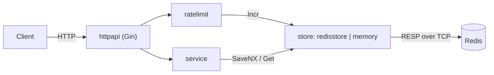

# URL shortener

Сервис сокращения ссылок на Go: REST API на Gin, хранение в Redis, ограничение частоты запросов по IP.

Учебный проект: цель была отработать Gin, Redis, HTTP и устройство небольшого сервиса от конфигурации до graceful shutdown.

## API

| Метод и путь | Что делает | Ответы |
|---|---|---|
| `POST /api/v1/shorten` | принимает `{"url": "https://..."}` и создаёт короткую ссылку | `201` с `code` и `short_url`, `400` при невалидном запросе или URL, `429` при превышении лимита |
| `GET /r/:code` | редирект на исходный URL | `302` с `Location`, `404` если кода нет или истёк TTL |
| `GET /healthz` | проверка живости сервиса и Redis | `200` или `503` |

```bash
curl -X POST localhost:8080/api/v1/shorten \
  -H 'Content-Type: application/json' \
  -d '{"url": "https://example.com/some/long/path?q=1"}'
# {"code":"uITwm3d","short_url":"http://localhost:8080/r/uITwm3d"}

curl -i localhost:8080/r/uITwm3d
# HTTP/1.1 302 Found
# Location: https://example.com/some/long/path?q=1
```

Превышение лимита:

```
HTTP/1.1 429 Too Many Requests
Retry-After: 30
{"error":"too many requests"}
```

## Запуск

```bash
task up          # Redis и сервис в Docker, http://localhost:8080
# или локально:
task redis       # только Redis
task run         # сервис на хосте
task test        # все тесты с -race
```

Без Task: `docker compose up --build`, `go run ./cmd/app`, `go test -race ./...`.

После клонирования один раз выполните `go mod tidy`: он создаст `go.sum`.

### Настройки (переменные окружения)

| Переменная | По умолчанию | Назначение |
|---|---|---|
| `PORT` | `8080` | порт HTTP-сервера |
| `BASE_URL` | `http://localhost:<PORT>` | префикс для `short_url` в ответе |
| `REDIS_ADDR` | `localhost:6379` | адрес Redis |
| `LINK_TTL` | `24h` | срок жизни короткой ссылки |
| `RATE_LIMIT` | `10` | сколько ссылок можно создать с одного IP за окно |
| `RATE_WINDOW` | `1m` | длина окна |
| `SHUTDOWN_TIMEOUT` | `10s` | сколько ждать завершения текущих запросов при остановке |

## Архитектура



```
cmd/app                 точка входа: сборка зависимостей, запуск, graceful shutdown
internal/config         настройки из переменных окружения
internal/entity         доменные ошибки
internal/service        бизнес-логика, ничего не знает про Gin и Redis
internal/ratelimit      fixed window поверх интерфейса Counter
internal/httpapi        хендлеры, middleware, роутер на Gin
internal/store/redisstore   реализация на Redis (go-redis)
internal/store/memory       та же логика в памяти: для тестов и отладки
```

Слои зависят друг от друга только через небольшие интерфейсы, которые описаны там, где используются (`urlStore` в `service`, `Shortener` и `Limiter` в `httpapi`). Поэтому сервис и HTTP-слой тестируются без Redis и без сети.

## Принятые решения

**`SetNX` при создании ссылки.** Схема «проверить, что код свободен, потом записать» уязвима: между проверкой и записью другой запрос может занять тот же код, и чужая ссылка будет перезаписана. `SET NX` делает проверку и запись одной атомарной операцией. При коллизии генерируется новый код (до 5 попыток).

**`crypto/rand`, а не `math/rand`.** Выход `math/rand` предсказуем: по нескольким кодам можно вычислить следующие. Байты `>= 248` отбрасываются, чтобы 62 символа base62 выпадали равновероятно (иначе первые 8 встречались бы чаще из-за остатка от деления).

**Rate limit через Lua-скрипт.** Схема fixed window: ключ `rl:<ip>`, `INCR`, на первом инкременте `PEXPIRE`. Если выполнять `INCR` и `EXPIRE` двумя командами и процесс упадёт между ними, ключ останется без TTL, а клиент будет заблокирован навсегда. Скрипт выполняется в Redis атомарно. Слабое место fixed window: на стыке окон возможен всплеск до двойного лимита. Для строгого сглаживания нужен sliding window или token bucket.

**Fail-open для лимитера.** Если счётчик недоступен, запрос пропускается, а в лог пишется предупреждение. Rate limit защищает от перегрузки, и его поломка не должна превращаться в недоступность всего сервиса. Для платёжных или связанных с безопасностью эндпоинтов выбирают fail-closed.

**`SetTrustedProxies(nil)`.** По умолчанию Gin доверяет заголовку `X-Forwarded-For`. Клиент мог бы подставлять в каждом запросе новый адрес и обходить лимит. Теперь используется адрес прямого соединения; тест это проверяет. За настоящим reverse proxy в `SetTrustedProxies` нужно указать его адрес.

**`302`, а не `301`.** Браузеры кэшируют `301` навсегда: ссылку с истёкшим TTL нельзя «отозвать» на стороне клиента.

**Только `http` и `https`.** Иначе можно «сократить» `javascript:...` или `file:...`.

**Маршрут `/r/:code`, а не `/:code`.** Статические маршруты (`/healthz`, `/api/...`) не конфликтуют с параметрическим на одном уровне дерева роутера.

**Graceful shutdown и fail-fast.** На `SIGTERM`/`Ctrl+C` сервер перестаёт принимать новые соединения и ждёт завершения текущих запросов (до `SHUTDOWN_TIMEOUT`). Если Redis недоступен при старте, сервис сразу падает с понятной ошибкой. `ReadHeaderTimeout` защищает от медленных клиентов (Slowloris).

## Тесты

```bash
task test   # go test -race -count=1 ./...
```

- `service`: валидация URL, коллизии кодов, исчерпание попыток, ошибки хранилища, TTL (с подменой времени).
- `ratelimit`: граница лимита, сброс окна, независимость клиентов, ошибка счётчика.
- `httpapi`: все статусы и заголовки, `X-Forwarded-For`, fail-open, сквозной сценарий на настоящих сервисе и лимитере.
- `redisstore`: интеграционные тесты на настоящем Redis (атомарность `SetNX` и `Incr` при 30–50 параллельных горутинах, TTL). Если Redis не запущен, они пропускаются: поднимите его командой `task redis`.

## Ограничения и что можно улучшить

- Redis без персистентности: после перезапуска ссылки пропадут. Для продакшена нужен AOF или основное хранилище (например, PostgreSQL) с Redis как кэшем.
- Одинаковый URL, отправленный дважды, получит два разных кода (дедупликации нет).
- Ошибка Redis при сохранении отдаётся как `500`; точнее было бы различать недоступность хранилища (`503`).
- Нет метрик и трассировки (observability).
